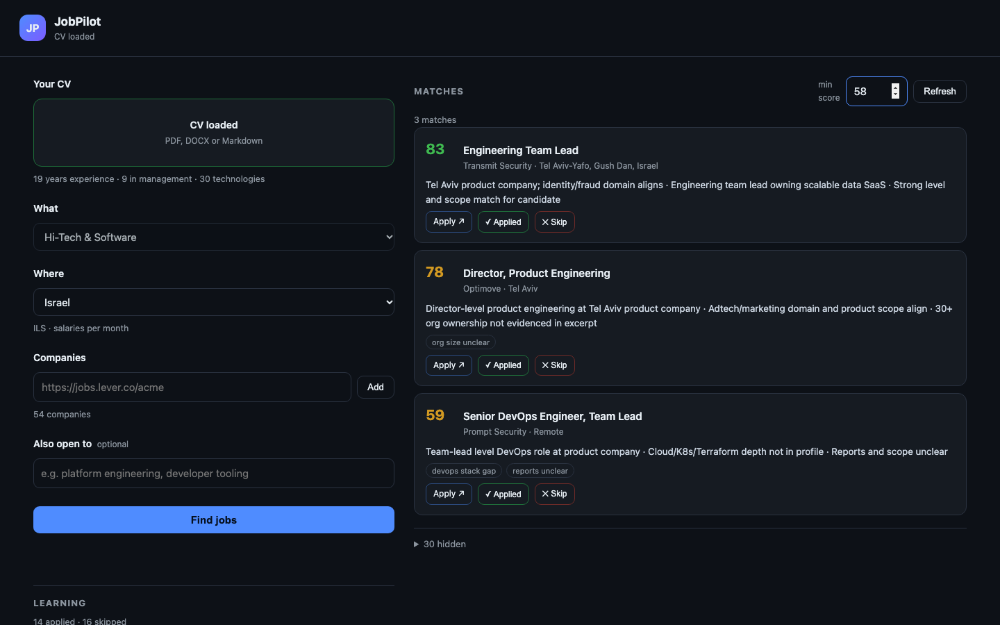

# JobPilot

**Find the jobs worth your time.**

---

JobPilot reads your CV, looks at every job open at the companies in its board
directory, and hands you a short list.

Each one is scored, explained in a sentence, and ready to apply to.

No searching. No scrolling. No LinkedIn.



---

## What it does

**Reads your CV** — your level, your skills, your background.

**Sorts the market** — it discards the wrong level, the wrong place, and anything you cannot take.

**Scores what is left** — out of 100, with a reason you can read.

---

## It learns from your decisions

Mark jobs **Applied** or **Skipped**, and the agent uses your decisions as
calibration evidence: it works out where your bar actually sits and shows the
model a few of your own postings as worked examples.

It starts at **five applied and ten skipped**. Below that a handful of clicks is
noise, so the scorer runs on your profile alone — `npm run learn` says how many
more it needs. The more you label, the closer the scores get to your judgement.

If you write a note when you skip something — "too far", "no more adtech" — the
agent reads it and proposes a rule. Nothing changes until you confirm it, and
every confirmed rule stays visible so you can remove it.

It does not invent a preference you never expressed, and it never moves your
threshold on its own — `npm run learn` tells you what it would suggest.

---

## Getting started

You need Node.js 24 or newer, and one AI key — DeepSeek, Anthropic, OpenAI or
OpenCode Go.

```bash
cd ~/Development/JobPilot
npm install
npm run init -- --market il
cp .env.example .env
./start.sh
```

Paste your key into `.env`, save, and the page opens.

Then, on the page:

1. **Drop your CV** — PDF or Word.
2. **Choose your country.**
3. **Press Find jobs.**

That is the whole setup.

---

## After you decide

| | |
|---|---|
| **Apply** | Opens the job. Nothing is saved. |
| **✓ Applied** | Saves it and clears it from the list. |
| **✕ Skip** | Hides it for good. |

Changed your mind? Press **Undo**, or open **hidden** below the list and bring any job back.

Your decisions also calibrate the scorer: once there are enough of them, it is
shown where your bar actually sits, and `npm run learn` suggests a minimum score.

---

## Private by default

Your CV, your jobs and your decisions stay on your own computer.

The only thing that leaves is the job text sent to the AI that scores it.

---

## What it will not do

It will not apply for you. It will not use LinkedIn. It will not send your data anywhere else.

---

## For contributors

The code is four packages — `ui`, `server`, `engine`, `storage` — with the rules
written down in [`AGENTS.md`](./AGENTS.md) and enforced by `npm test`.

| Read | For |
|---|---|
| [`AGENTS.md`](./AGENTS.md) | the package rules, and where new code goes |
| [`docs/ENGINE.md`](./docs/ENGINE.md) | diagrams: a run, discovery, the profile path |
| [`docs/SERVER.md`](./docs/SERVER.md) | diagrams: routes and the live run stream |
| [`docs/STORAGE.md`](./docs/STORAGE.md) | diagrams: the schema and its two key queries |
| [`docs/LEARNING.md`](./docs/LEARNING.md) | how decisions become calibration, and how that is measured |
| [`docs/DECISIONS.md`](./docs/DECISIONS.md) | why it is built this way, and what would reverse it |

`npm test` type-checks and runs the suite; `npm run typecheck` runs only the
compiler.

---

## License

MIT — see [LICENSE](./LICENSE).
